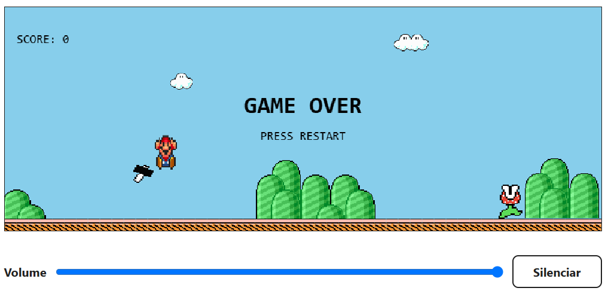
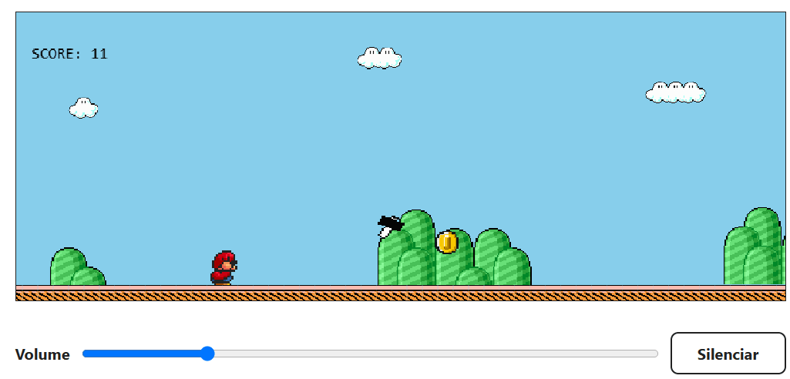
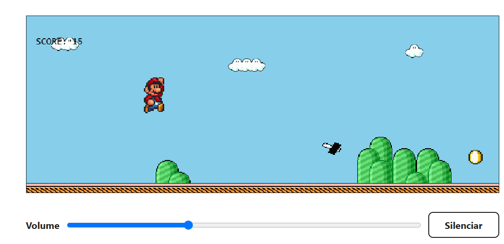
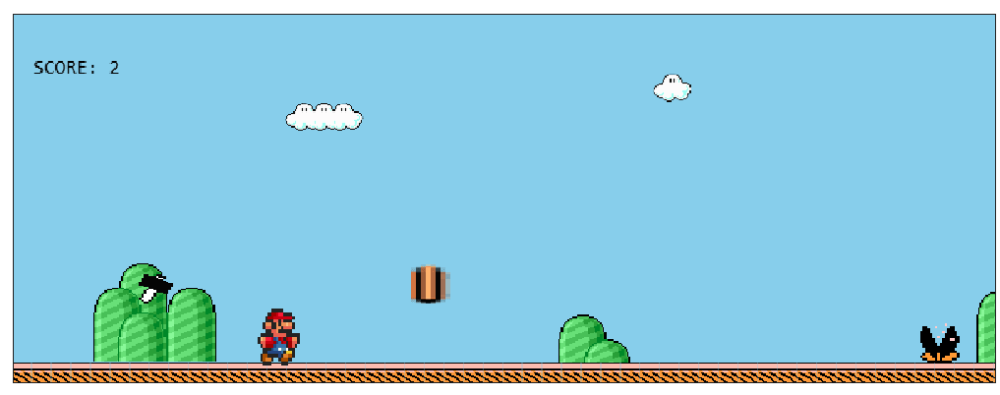

# 🍄 Mario Runner

Um endless runner inspirado na nostalgia dos jogos de plataforma clássicos. Corra com Mario, desvie de obstáculos, colete itens e tente alcançar a maior pontuação possível!

O projeto combina uma experiência simples e responsiva com uma arquitetura preparada para evoluir, utilizando TypeScript, Vite e testes automatizados.

> Projeto independente, desenvolvido para fins de estudo e entretenimento.

[🎮 Clique aqui para jogar](https://mario-runner.vercel.app/), ou acesse https://mario-runner.vercel.app

---

## 🎮 Sobre o jogo

Mario Runner é um jogo de corrida infinita inspirado na simplicidade do Chrome Dino Game, com personagens, sprites e elementos visuais inspirados em Super Mario Bros. 3.






### Funcionalidades

- Corrida infinita
- Pulo e agachamento para desviar dos obstáculos.
- Power-up de cogumelo que transforma Mario.
- Moedas e medalhas que aumentam a pontuação.
- Colisões, perda de poder e morte.
- Música de cenário e efeitos sonoros.
- Controles por teclado e touch, com suporte a dispositivos móveis.
- Suporte offline por meio de Service Worker, após o carregamento e armazenamento dos recursos necessários.

## 🕹️ Como jogar

### Controles de teclado

| Ação    | Controle             |
| ------- | -------------------- |
| Pular   | `ArrowUp` ou `Space` |
| Agachar | `ArrowDown`          |

Em dispositivos móveis, utilize os controles touch disponibilizados pelo jogo.

### Pontuação

| Item    | Pontos |
| ------- | -----: |
| Moeda   |      1 |
| Medalha |      2 |

A cada 20 pontos, o nível aumenta e a dificuldade progride. Evite os obstáculos, aproveite os coletáveis e utilize os power-ups para prolongar sua corrida.

## 🛠️ Tecnologias

- [Vite](https://vite.dev/) — servidor de desenvolvimento e build.
- [TypeScript](https://www.typescriptlang.org/) — tipagem estática e TypeScript estrito.
- [pnpm](https://pnpm.io/) — gerenciamento de dependências.
- [ESLint](https://eslint.org/) — análise estática e qualidade de código.
- [Prettier](https://prettier.io/) — formatação consistente.
- [Vitest](https://vitest.dev/) — testes automatizados.
- HTML, CSS, Canvas API e Service Worker — apresentação, renderização e suporte offline.

## 🚀 Como executar localmente

### 1. Clone o repositório

```bash
git clone https://github.com/lucianakyoko/mario-runner.git
cd mario-runner
```

### 2. Instale as dependências

```bash
pnpm install
```

### 3. Inicie o servidor de desenvolvimento

```bash
pnpm dev
```

Abra no navegador a URL local exibida pelo Vite.

## 🧪 Qualidade e testes

O projeto utiliza testes automatizados para verificar regras importantes do jogo, priorizando a lógica de domínio e o comportamento da aplicação.

Execute os comandos a seguir na raiz do projeto.

### Executar os testes

```bash
pnpm test
```

O Vitest executa os testes em modo de execução única.

### Verificar os tipos TypeScript

```bash
pnpm typecheck
```

### Executar o ESLint

```bash
pnpm lint
```

### Verificar a formatação

```bash
pnpm format:check
```

### Formatar os arquivos

```bash
pnpm format
```

### Executar o build de produção

```bash
pnpm build
```

O build executa, nesta ordem:

1. Compilação e verificação do TypeScript.
2. Build de produção com Vite.
3. Geração do Service Worker com os recursos necessários para o cache offline.

### Testar a versão de produção localmente

Depois de gerar o build:

```bash
pnpm preview
```

Use a URL exibida pelo Vite para acessar a versão de produção.

## 🏗️ Arquitetura

O projeto segue os princípios de Clean Architecture, separando as regras de negócio da infraestrutura e da apresentação.

A estrutura busca manter responsabilidades claras, baixo acoplamento e lógica de domínio testável sem depender diretamente do navegador ou da renderização.

### Responsabilidades das camadas

**Domain (`src/domain/`)**

Contém as regras de negócio do jogo, incluindo física e movimentação do Mario, pontuação, progressão de nível, colisões, obstáculos, coletáveis, power-ups, dificuldade e randomização.

**Application (`src/application/`)**

Coordena o funcionamento do jogo, o game loop, as transições de estado, o tempo, a entrada e os contratos de áudio.

**Infrastructure (`src/infrastructure/`)**

Implementa integrações concretas com recursos da plataforma, como áudio do navegador, teclado, touch, agendamento de frames e geração pseudoaleatória com seed.

**Presentation (`src/presentation/`)**

Cuida da representação visual do jogo, do Canvas, dos sprites e dos elementos de interface.

**Public (`public/`)**

Armazena os recursos estáticos, incluindo sprites, músicas, efeitos sonoros e o Service Worker utilizado pelo projeto.

## ⚙️ Princípios de implementação

O desenvolvimento prioriza:

- TypeScript estrito, evitando o uso de `any`.
- Separação entre regras de negócio, infraestrutura e apresentação.
- Game loop baseado no tempo decorrido (`deltaTime`), sem pressupor FPS fixo.
- Máquina de estados para controlar o fluxo de gameplay.
- Configuração centralizada dos parâmetros do jogo.
- Colisões reutilizáveis e independentes das dimensões visuais dos sprites.
- Randomização pseudoaleatória com suporte a seed para testes reproduzíveis.
- Testes automatizados para regras relevantes do domínio.
- Limpeza adequada de listeners, recursos de áudio e ciclos de animação.

Esses princípios permitem evoluir o jogo sem concentrar regras de negócio no renderizador ou depender de APIs específicas do navegador dentro do domínio.

## 🔊 Áudio

O jogo possui música de cenário e efeitos sonoros para diferentes ações e eventos, como:

- Pulo.
- Coleta de moeda e medalha.
- Ativação de power-up.
- Transformação e perda de poder.
- Morte e colisões.

A aplicação utiliza um serviço de áudio desacoplado das regras de negócio, permitindo evoluir a implementação e adicionar novos recursos sonoros.

A reprodução de áudio pode depender da interação inicial do usuário e das políticas do navegador.

## 🌐 Funcionamento offline

O Mario Runner utiliza Service Worker para disponibilizar recursos do jogo sem conexão com a internet. O projeto não utiliza PWA.

Durante o build, o script `scripts/generate-service-worker.mjs` gera `dist/sw.js` e prepara a lista de recursos estáticos que devem ser armazenados em cache.

Os recursos incluem:

- HTML de entrada.
- Arquivos JavaScript e CSS gerados pelo Vite.
- Sprites dos personagens, cenário, obstáculos e itens.
- Música e efeitos sonoros.

### Como funciona

1. O usuário acessa o jogo enquanto está conectado à internet.
2. O navegador instala e ativa o Service Worker e armazena os recursos necessários.
3. Em acessos posteriores, os recursos armazenados em cache podem ser utilizados sem conexão.
4. Quando a conexão é restabelecida, a navegação normal volta a utilizar a rede, quando disponível.

### Limitações

- O primeiro acesso exige conexão para carregar o jogo e armazenar seus recursos.
- O funcionamento offline depende do navegador oferecer suporte a Service Workers e de o jogo já ter sido carregado e armazenado em cache.
- O Service Worker funciona dentro do escopo do próprio site. Ele não substitui a página de erro de conexão do navegador em outros sites.
- Atualizações dos recursos podem exigir a instalação de uma nova versão do Service Worker e a atualização do cache.

Para testar o comportamento offline, gere o build de produção, sirva-o por HTTP local ou HTTPS e utilize as ferramentas de desenvolvedor do navegador para simular a desconexão. Verifique o carregamento dos sprites, a execução do jogo e a reprodução de áudio.

## ♿ Acessibilidade e responsividade

O projeto considera diferentes tamanhos de tela e formas de interação, incluindo teclado e dispositivos touch.

A implementação também busca manter os estados do jogo perceptíveis, evitar dependência exclusiva de áudio ou cor e respeitar preferências de movimento reduzido quando aplicável.

## 🗺️ Evolução do projeto

A arquitetura foi planejada para permitir a adição gradual de novos recursos, como:

- Novos personagens e animações.
- Obstáculos, inimigos e coletáveis adicionais.
- Power-ups e transformações.
- Cenários com fundos, músicas e configurações próprias.
- Novos efeitos sonoros e comportamentos.
- Melhorias de acessibilidade, desempenho e experiência mobile.

## 👩‍💻 Autoria

Desenvolvido com ♥ por [Luciana Kyoko](https://lucianakyoko.vercel.app/).

---

**Mario Runner** uma corrida nostálgica, um salto de cada vez. 🍄
